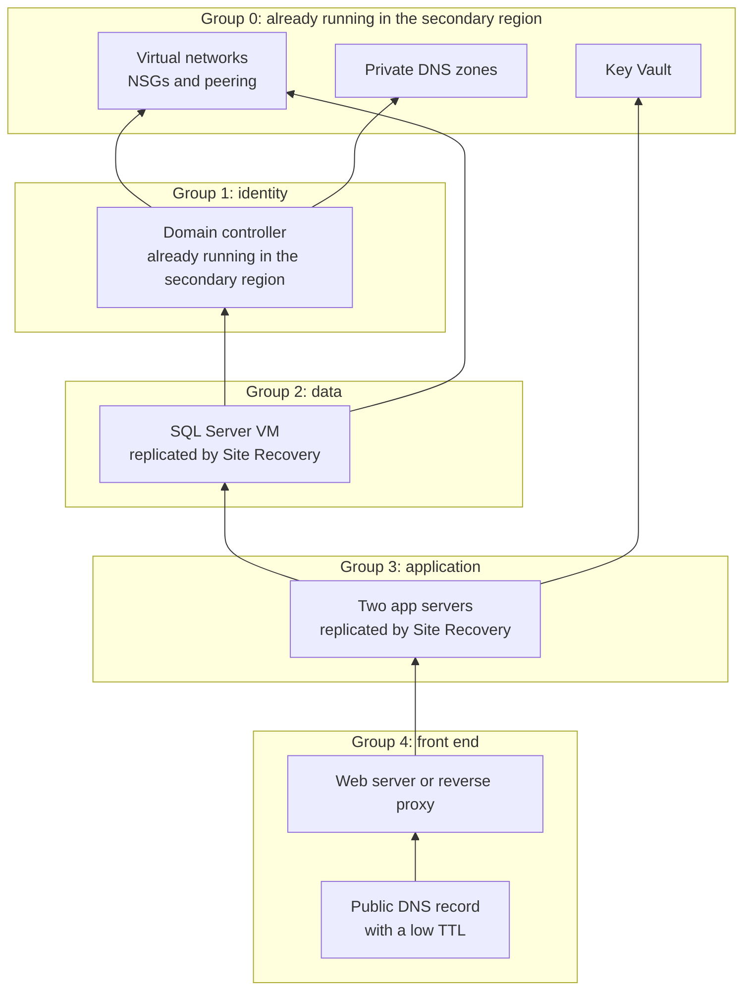

# Dependency Map and Failover Order

This is an example for a three-tier order processing app. The same method works for any app. List what each part needs before it can start, then bring the parts up in that order.

The map shows a real failover. A test failover is different for the domain controller. See [Domain controllers](#domain-controllers).

## Dependencies

Arrows point from a part to what it needs.

## Recovery plan groups

A recovery plan in Site Recovery starts VMs in groups. Group 1 has to finish before group 2 starts, and so on. You can add a script or a manual step between groups.

| Group | What's in it | Starts after | Check before the next group |
|---|---|---|---|
| 0 | Networks, private DNS, Key Vault | Deployed ahead of time in both regions from templates | Peering is connected. Key Vault answers through its private endpoint. |
| 1 | Domain controller | Already running in the secondary region. It isn't in the recovery plan. | `nltest /dsgetdc:<domain>` works from a test VM and internal names resolve. |
| 2 | SQL Server | Group 1 | The SQL service is running, the databases are online and `SELECT @@SERVERNAME` returns. |
| 3 | App servers | Group 2, plus a script that updates the connection string if the database name changed | The app's health page returns 200 and the app log shows a database connection. |
| 4 | Web server, public DNS | Group 3, plus a manual step to change the public DNS record or load balancer target | A test order goes through from outside. |

## Domain controllers

For a real failover, keep a domain controller running all the time in the secondary region. It stays current through normal Active Directory replication, so it doesn't need to be in the recovery plan.

That domain controller is joined to your real network, so it can't be brought into the isolated test network. For a test failover, also replicate one domain controller with Site Recovery and test fail it over into the test network before the recovery plan. Use the latest app-consistent recovery point. Don't bring every domain controller into the test network. Microsoft's guide on [Active Directory and Site Recovery](https://learn.microsoft.com/azure/site-recovery/site-recovery-active-directory) has the details, including what to do if SYSVOL doesn't come up.

## When something fails during the failover

| What fails | What to do |
|---|---|
| A group 2 VM won't boot | Retry from the latest app-consistent recovery point. If it still fails, restore it from backup with Cross Region Restore and carry on. Write down how much time it cost. |
| The app can't reach SQL | Check the SQL name resolves to the new IP address, the NSG rules in the secondary region allow it and the SQL listener is up. |
| The secondary region doesn't have capacity for a VM size | Change the target VM size under Protected items → Replicated items → the VM → Compute, or wait. This is why capacity reservations are worth it for the most important systems. |
| Key Vault can't be reached | The app can't get its secrets. Check the private endpoint and that the private DNS zone is linked to the virtual network in the secondary region. |
